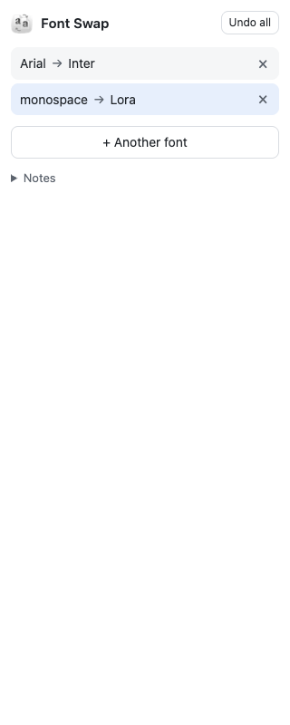
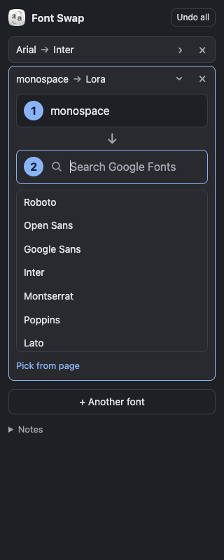
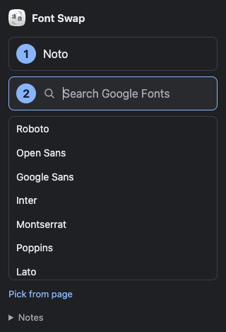
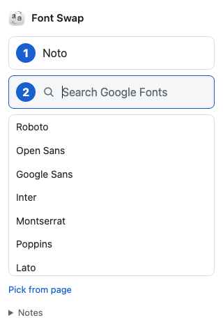

# Verification

Verified 2026-10-08T03:11:15.252Z on macOS arm64, Node 24, Chrome for Testing 152.0.7977.75.

Manifest and syntax checks passed. Five unit tests passed. All 32 end-to-end browser checks passed. Font downloads were real, and Chrome's CSS protocol confirmed Lora glyphs in the rendered heading.

The fixture browser used loopback-only permissions in a temporary manifest copy to exercise permitted frames. The native-panel browser used the exact production manifest and a real toolbar action. Test browsers, fixture servers and temporary profiles were closed.

- hover shows font name and picking removes tooltip
- picker detects primary CSS family and selected text
- real Google Font downloads and renders actual Lora glyphs over inline important
- fallback-only matches, similar names and private-use icons stay unchanged
- open and closed shadow DOM text swaps
- dynamic page text joins current font mapping
- continuous DOM updates do not starve matching
- two different origin fonts stay applied together and hover shows replacement name
- removing one swap preserves the other
- page picking a replaced Google font survives removal of its original swap
- editing a swap replaces its destination without duplicating the pair
- instant application needs no Apply and internal comparison remains reversible
- Undo preserves website styling changes including shadow inline changes
- fallback detection is labelled CSS identity rather than confirmed rendered font
- absent source produces zero matches and no misleading success
- selected element scope only changes selected element
- destination can be picked from existing page text
- page-picked CSS generic font keeps generic semantics
- destination failure retains previous preview
- offline uncached font fails safely and cached font still previews
- strict website CSP with font-src none supports worker-loaded FontFace
- destination picker stays in origin document
- moving origin to another frame preserves previous swaps
- Undo all restores simultaneous swaps across permitted frames
- restricted browser page reports unsupported action
- production manifest toolbar gesture opens native panel and grants activeTab
- native panel searches, applies instantly, edits by keyboard and undoes on public iana.org
- native panel adds simultaneous pairs while production permissions protect cross-origin frames
- minimal two-pair panel fits 320px and renders light and dark themes
- native panel removes one pair independently and Undo all restores the rest
- native panel page-picked destination applies immediately and collapses to pair
- native panel reconnects after navigation and Escape cancels picker

## Manual Dia checks

Checked the installed unpacked v0.2.0 extension through Dia's native UI on 8 October 2026, using https://ai-nativeservices.com/blog/integral-ai-native-accounting.

- Reloaded the installed extension, then refreshed the article.
- Toolbar opened the minimal two-pick panel with the supplied icon.
- Hover showed Gelasio for the heading and Figtree for body text.
- Picked Gelasio, searched Lora, and pressed Enter. Heading and site brand changed immediately, with no Apply control.
- Added Figtree to Roboto Mono. Both pairs stayed active, with visible serif heading and monospace body.
- Removed only Figtree to Roboto Mono. Body restored while the Lora heading remained.
- Edited the remaining pair, picked Figtree from the article as destination, and saw heading and site brand change immediately.
- Undo all restored original fonts. Escape cancelled the picker. Reload cleared the session and reconnected to the two-pick starting state.

The user's existing extensions stayed installed and enabled. The manual test used the user's Dia profile; automated tests used isolated profiles.

## In-app browser limitation

The Codex in-app browser's control policy rejected chrome://extensions because only HTTP and HTTPS navigation is allowed. Extension installation and native side-panel end-to-end testing there could not be completed. No workaround was attempted. Dia and Chrome test success does not establish in-app compatibility.

## Panel at 320px

These results cover the listed cases on the tested browsers. They do not establish exact glyph detection or universal browser compatibility. See README boundaries.

## Search field in v0.2.1

The second pick uses a search icon, Search Google Fonts label and placeholder, a filled background, and native search input. Clicking the row focuses the field. The actual native Chrome panel was visually checked at 320px in light and dark themes. All 32 browser checks and five unit tests passed again. The Dia manual checks above refer to v0.2.0; concurrent user input prevented repeating them for this visual patch.

