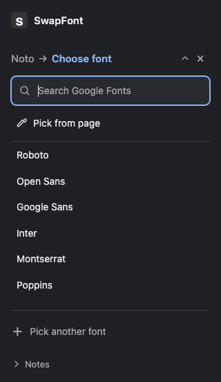
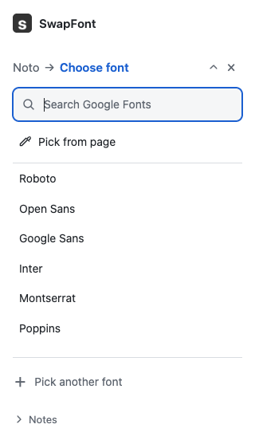
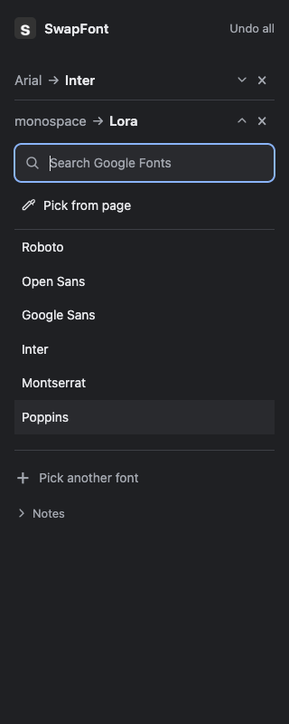
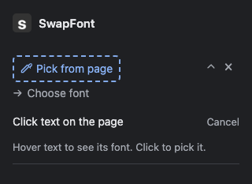
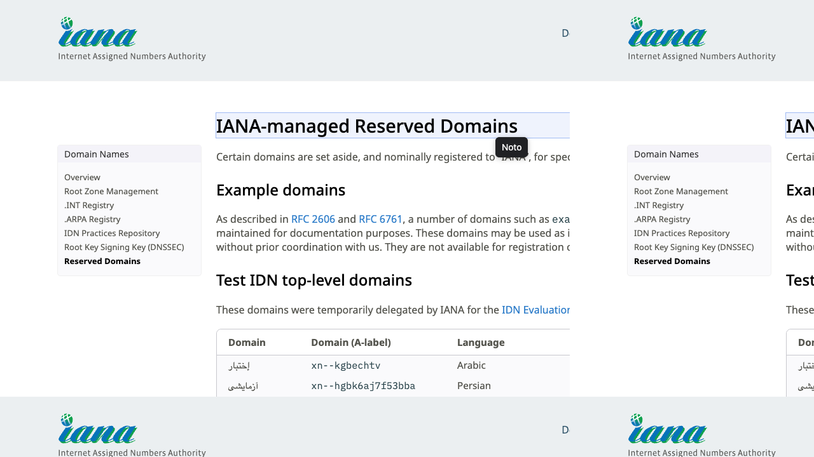
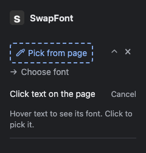
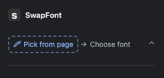

# Verification

Verified 2026-10-08T06:06:53.629Z on macOS arm64, Node 24, Chrome for Testing 152.0.7977.75.

Manifest and syntax checks passed. Five unit tests passed. All 48 end-to-end browser checks passed. Font downloads were real, and Chrome's CSS protocol confirmed Lora glyphs in the rendered heading.

The fixture browser used loopback-only permissions in a temporary manifest copy to exercise permitted frames. The native-panel browser used the exact production manifest and a real toolbar action. Test browsers, fixture servers and temporary profiles were closed.

- source hover shows hand cursor, subtle highlight and font name; picking restores website styles
- both pickers show on-page instructions; Escape restores cursors and cancels frames, including shadow text
- picker detects primary CSS family and selected text
- real Google Font downloads and renders actual Lora glyphs over inline important
- fallback-only matches, similar names and private-use icons stay unchanged
- open and closed shadow DOM text swaps
- dynamic page text joins current font mapping
- continuous DOM updates do not starve matching
- two different origin fonts stay applied together and hover shows replacement name
- removing one swap preserves the other
- page picking a replaced Google font survives removal of its original swap
- editing a swap replaces its destination without duplicating the pair
- instant application needs no Apply and internal comparison remains reversible
- Undo preserves website styling changes including shadow inline changes
- fallback detection is labelled CSS identity rather than confirmed rendered font
- absent source produces zero matches and no misleading success
- selected element scope only changes selected element
- destination can be picked from existing page text
- page-picked CSS generic font keeps generic semantics
- destination failure retains previous preview
- offline uncached font fails safely and cached font still previews
- strict website CSP with font-src none supports worker-loaded FontFace
- destination picker stays in origin document
- moving origin to another frame preserves previous swaps
- Undo all restores simultaneous swaps across permitted frames
- restricted browser page reports unsupported action
- production manifest toolbar gesture opens native panel and grants activeTab
- a page state update between native pointer press and release preserves the result and applies the font
- saved pair opens and closes inline without removing the pair or changing the applied font
- native panel searches, applies instantly, edits by keyboard and undoes on public iana.org
- empty panel reuses the Pick from page row; clicking starts picking and Escape leaves it idle without an intro screen
- adding a font opens a blinking dashed source placeholder that wraps at 240px with picking controls inside its accordion; Cancel preserves swaps
- pending row opens, closes and discards without affecting an applied swap
- native panel adds simultaneous pairs while production permissions protect cross-origin frames
- switching accordion rows keeps both swaps applied and expands one editor at a time
- expanded two-pair accordion fits 320px and renders light and dark themes
- native panel removes one pair independently and Undo all restores the rest
- native panel page-picked destination applies immediately and collapses to pair
- native panel reconnects after navigation and Escape cancels picker

## Manual Dia checks

Checked the installed unpacked v0.2.0 extension through Dia's native UI on 8 October 2026, using https://ai-nativeservices.com/blog/integral-ai-native-accounting.

- Reloaded the installed extension, then refreshed the article.
- Toolbar opened the minimal two-pick panel with the supplied icon.
- Hover showed Gelasio for the heading and Figtree for body text.
- Picked Gelasio, searched Lora, and pressed Enter. Heading and site brand changed immediately, with no Apply control.
- Added Figtree to Roboto Mono. Both pairs stayed active, with visible serif heading and monospace body.
- Removed only Figtree to Roboto Mono. Body restored while the Lora heading remained.
- Edited the remaining pair, picked Figtree from the article as destination, and saw heading and site brand change immediately.
- Undo all restored original fonts. Escape cancelled the picker. Reload cleared the session and reconnected to the two-pick starting state.

The user's existing extensions stayed installed and enabled. The manual test used the user's Dia profile; automated tests used isolated profiles.

## Manual Dia checks for v0.2.1

Reloaded the installed extension to v0.2.1 and tested https://www.iana.org/domains/reserved through Dia's native UI on 8 October 2026.

- Picked Noto, searched Lora, and clicked the result. The page changed immediately.
- Opened and closed the saved row. Its editor expanded inside the row, and the Lora rendering and saved pair remained.
- Reopened the row, searched Inter, and pressed Enter. The same pair changed to Inter.
- Added IBM Plex Mono to Roboto Mono. Switching accordion rows kept both swaps active and showed one editor at a time.
- Used the eyedropper page picker to change the second destination to Inter from the heading.
- Removed only the second pair, leaving Noto to Inter. Undo all restored the test page. Closed the test tab and restored the user's original Poppins source selection on their AICamp page.
- Visually confirmed the search icon, Search Google Fonts field, down arrow between picks, and eyedropper to the left of Pick from page.

## In-app browser limitation

The Codex in-app browser's control policy rejected chrome://extensions because only HTTP and HTTPS navigation is allowed. Extension installation and native side-panel end-to-end testing there could not be completed. No workaround was attempted. Dia and Chrome test success does not establish in-app compatibility.

## Panel at 320px

These results cover the listed cases on the tested browsers. They do not establish exact glyph detection or universal browser compatibility. See README boundaries.

## Search and accordion in v0.2.1

The second pick uses a search icon, Search Google Fonts label and placeholder, a filled background, and native search input. Clicking the row focuses the field. The actual native Chrome panel was visually checked at 320px in light and dark themes. All 34 browser checks and five unit tests passed again. Saved pairs expand the two-pick editor inside their row, with one row open at a time. Opening, closing and switching rows preserves the applied fonts. A down arrow connects the two picks. The × button removes a pair independently. Pick from page has a decorative eyedropper icon to its left. The v0.2.1 changes also passed the manual Dia checks recorded above.

## Compact picker in v0.2.2

The panel follows the supplied three-state reference. A pending source row opens one replacement picker containing search, Pick from page and results. Applied swaps become compact rows with muted source names, bold destinations, chevrons and separate remove buttons. Numbered cards and the repeated source box are gone. Row and Notes chevrons are SVG icons. Notes retains native mouse and keyboard disclosure behavior. The updated drawing.svg supplies all icon sizes, and the extension is named SwapFont.

Manifest and syntax checks, five unit tests and all 38 browser checks passed. The new pending-row check confirms closing, reopening and discarding a choice preserves an existing swap. Visually checked the native Chrome panel at 320px in light and dark themes.

## Picking feedback in v0.2.2

Starting another source pick opens a pending accordion with a blinking dashed Pick from page label, eyedropper icon, instructions and Cancel inside it. Loading and errors appear in the active row. A temporary on-page eyedropper badge says Pick a font or Pick replacement font. Both pickers use a hand cursor, thin blue outline, translucent fill and font-name tooltip on text. Picking or Escape restores the site's cursor, outline and background. Escape also cancels other permitted frames.

Browser checks cover custom important cursors, restoration on picking and Escape, shadow text, frame cancellation, badge removal, and cancelling a pending accordion without opening or changing an existing swap. Visually checked picking feedback on light and dark blue page backgrounds. The source placeholder uses an 8px rounded 2px dashed border, a muted blue and a border-only opacity pulse. Reduced motion keeps it static. Unchanged result nodes survive page state updates, preventing a press/release click from being lost; passive updates also preserve list scroll position.

## Simplified empty panel in v0.2.3

Removed the separate intro screen. An empty panel uses the same Pick from page accordion as adding a font. Clicking it starts picking. Escape and Cancel stop picking and leave that row static and clickable. Undo all and removing the last swap return to that row. A delayed reconnect waits for active panel actions, and connection responses cannot replace newer state. Five unit tests and all 39 browser checks passed.

## Picker feedback v0.2.5

Replaced the hand-drawn eyedropper with the Lucide pipette in the source row, replacement picker and on-page badge. The dashed border now blinks every 0.8 seconds, holding full brightness and 10% opacity between short fades. Text and icon stay steady. Reduced motion and idle rows remain static.

Verified the bright and dim phases in light and dark themes, 16px icon rendering, and reduced motion in the native production-manifest panel. All 39 end-to-end checks and five unit tests passed.

## Font loading feedback v0.2.6

Added a small spinner beside the loading message inside the active font accordion. It appears while downloading a Google Font and for page-picked replacements, then clears on completion or failure. The spinner reuses the connection indicator and respects reduced motion.

Held a real Google Font download open in the production-manifest native panel, verified its loading message and spinner inside the accordion, then released it and confirmed the applied swap and cleared spinner. All 40 end-to-end checks and five unit tests passed.

## Floating panel v0.3.0

Added a separately packaged SwapFont Floating build. It reuses the sidebar controls inside a closed shadow root, with a draggable header, keyboard movement, viewport clamping and a close button. Closing stops picking and keeps active swaps. Reopening reuses the panel. Its text and controls are excluded from detection and font replacement.

All 46 end-to-end checks and five unit tests passed. The floating production manifest was tested for unchanged page width, real Google Font loading and spinner, source and replacement picking, multiple swaps, accordion editing, drag and keyboard movement, narrow viewport, Escape, close/reopen, Undo, light/dark themes and strict CSP with frame-src none, style-src none and Trusted Types restrictions. No additional permanent website permission or web-accessible code is needed.

## Unified modes v0.4.0

One manifest and ZIP now include both native side panel and floating panel. The header icon switches modes, cancels active picking and preserves multiple font swaps. The toolbar remembers the last mode across browser restarts. New installs start in the side panel. Notes and the CSS-family/fallback explanation are removed from both modes.

Five unit tests and all 48 end-to-end checks passed. Mode handoffs were tested using real pointer clicks in both directions, with multiple swaps active, picking cancellation, panel visibility and mode storage. The Chrome 116 through 140 close fallback was exercised with close() unavailable in Chrome 152. Existing font rendering, loading, Undo, strict CSP/Trusted Types, dragging, narrow layouts and light/dark checks passed. Temporary browsers, profiles and servers were closed.

## Page picking guidance v0.4.1

Picking instructions and Cancel now appear only on the webpage, for source and replacement picks in both panel modes. The compact isolated card has an accent pipette, a stronger title, aligned secondary help text, and a separate Cancel button with an Esc keycap. The accordion keeps its blinking dashed source row without duplicate instructions.

Five unit tests and all 48 browser checks passed. Checks cover real pointer clicks on page-level Cancel, preserving existing swaps, source and replacement guidance, a 320px viewport, strict CSP and Trusted Types, both panel modes, Escape, instant replacements and remembered mode. Native browser test clicks wait for stable control geometry before dispatching pointer events. Temporary browsers, profiles and servers were closed.

## Saved sites, v0.5.0

Seven unit tests and 56 browser checks passed. New checks save only main-page font names, restore multiple pairs after reload, another path, a new tab and a full browser restart, match dynamic text, isolate a different hostname, update edited pairs, forget a site without clearing its current preview, restore page-picked fonts and clear saved pairs with Undo all. A mocked permission denial leaves the checkbox off and the preview intact. The request contains only the selected host pattern. Fixture loopback permissions are already granted; the native optional permission prompt needs a separate manual check. Chrome's port-wide host permission is separate from the exact origin used for settings.

Restoration targets document IDs. Saving binds the origin to the main document state and verifies the current origin before writing, so navigation cannot save the previous page's pairs against a different site. Embedded-frame and single-element pairs remain temporary. Both layouts use the same native checkbox below Pick another font.
